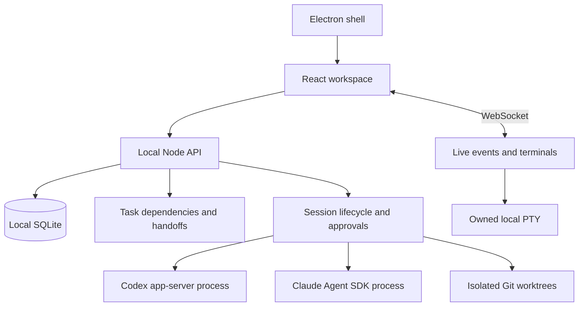

# Local architecture

## Decisions for the first foundation

Relay uses a pnpm TypeScript workspace with shared typed contracts, a React/Vite web client, a Node application server and an Electron shell. The app owns the local workspace state; each provider owns its conversation runtime. This follows the architectural separation observed in T3 Code without importing its source or depending on its packages.

The server owns project registration, session metadata, SQLite persistence, durable events, file boundaries, Git commands, worktrees, task dependencies, approval routing and terminal processes. Provider adapters translate supported harness events into the small shared AgentAdapter contract. The UI calls the local application API; it never receives credentials or launches provider processes directly.

WebSockets carry live state changes, text deltas and PTY data. SQLite stores accepted messages and durable workspace events. On reconnect the client reads the current bootstrap state; the event endpoint supports ordered replay. This initial design uses a single local node. Network membership, cross-node delivery and distributed ownership need a separate authenticated protocol.

## Isolation and approvals

Each independent session gets an isolated Git worktree by default. A worktree separates edits; it is not an operating-system sandbox. Provider sandbox controls and host approvals remain responsible for tool execution. The application file API separately validates canonical paths, symlinks, secret filenames and session/project ownership.

Supervised and balanced policies are implemented using supported provider permission modes. No provider adapter may respond to an unknown approval request with unrestricted access. Outstanding approvals expire on interruption and application restart. A restarted application restores a session's metadata and provider conversation identifier; it does not pretend a killed tool process is still running.

The API listens on loopback. Browser origins and WebSocket ownership are checked because the local API can write project files and start a terminal. This is a single-user local trust boundary; remote access is not enabled by changing the host binding.

## Integration semantics

An artifact handoff is a durable reference to a committed file at a specific revision. It gives the receiving session relevant context without resending an entire transcript. It does not merge the source branch or imply acceptance. Task completion remains distinct from an agent finishing a turn: a successful task run enters review.

## Desktop shell

The first Electron entry point starts the same local server on a selected loopback port and opens the built web client in a sandboxed window. It requires the local Node runtime used to install dependencies, preserving native PTY compatibility. Desktop application data lives in Electron's user-data directory. Installer packaging, code signing, update delivery and bundled runtime distribution remain later release work.
